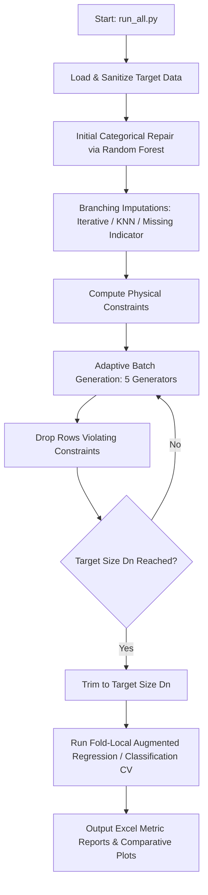

# SynthDataGen: Rigorous Tabular Synthetic Data Generation & Cross-Validation Framework

A robust, pipeline-driven framework designed to generate and evaluate tabular synthetic data under physical constraints. The architecture enforces zero-leakage, fold-local evaluation environments to benchmark synthetic data augmentation against real-world baselines using advanced classification and regression estimators.

##  Features

### 1. Leakage-Free Fold-Local Isolation
Unlike naive pipelines that generate synthetic data globally and cause data leakage into cross-validation folds, this framework implements **Strict Fold-Local Generation**:
* **Train/Test Splitting:** Raw real data is split into `real_train` and `real_test` boundaries *prior* to synthesis.
* **In-Fold Processing:** Missing value imputations and constraint parameters are fitted strictly on `real_train` and applied downstream to prevent target leakage.
* **Isolated Generation:** Synthetic data is generated using models trained solely on `real_train`, ensuring the `real_test` fold remains completely untouched until final evaluation.

### 2. Multi-Branch Parallel Imputation
To isolate the effects of missing data structures on synthetic generation quality, the engine evaluates three parallel preprocessing pathways:
* **`iter` (Iterative):** Multivariate, iterative feature modeling via `IterativeImputer`.
* **`knn` (Instance-based):** Proximity-based imputation using `KNNImputer` (5 neighbors).
* **`mi` (Indicator-driven):** Median/Mode imputation augmented with explicit `MissingIndicator` tracks, which are programmatically pruned post-generation to prevent metric pollution.

### 3. Constraint-Checked Synthetic Sampling
Five generators (Sequential CART, Gaussian Copula, CTGAN, CopulaGAN, TVAE) run through one in-memory, adaptive batching loop:
* **Physical Validity:** Every synthetic row must satisfy the training data's per-column bounds and any user-defined cross-column constraints; violating rows are discarded and regenerated.
* **No Statistical Gate:** Batches are not filtered on fidelity metrics, so all generators are compared on their raw output and the reported fidelity is not inflated by selection.
* **Dynamic Sizing:** Batch size (`min_batch_size=500` to `max_batch_size=24000` rows) adapts to the observed share of valid rows.
* **Class Balance Without Duplicates:** When a classification target is set, synthetic rows are generated to equal per-class quotas instead of being oversampled.

---

## 📊 Metrics

The framework runs an exhaustive, multi-dimensional quality analysis (`evaluate_all`) to profile the fidelity and privacy metrics of the generated distributions:

| Dimension | Evaluation Metrics Implemented |
| :--- | :--- |
| **Statistical Fidelity** | Mean Kolmogorov-Smirnov (KS) complement, Total Variation (TV) complement, Wasserstein Distance (WD), Maximum Mean Discrepancy (MMD) with RBF kernels. |
| **Structural Integrity** | Correlation Frobenius norms, Standardized Covariance norms, Matrix Boundary coverage ratios, Constraint Violation frequencies. |
| **Generative Alignment** | Multivariate Fréchet Distance (Gaussian approximation), Gaussian Mixture Model (GMM) Log-Likelihood clustering, Propensity Scores ($1 - 2 \times \text{AUC}$). |
| **Privacy Constraints** | Distance to Closest Real Record (`DCR_mean`/`DCR_min`), Nearest Neighbor Distance Ratio (`NNDR_mean`). |

---

## Pipeline Architecture



---

## Usage

### Prerequisites & Installation
Ensure you have working C++ compilers for tree-based packages, then set up the repository:
```bash
git clone https://github.com/dsquarre/SynthDataGen.git
cd SynthDataGen
pip install -r requirements.txt
```
Place your tabular files inside the `datasets/` folder and boot the automated runner:
```bash
python run_all.py
```

The interactive terminal will prompt you to configure:
1. Column drops and explicit metadata overrides (`n` for numerical, `c` for categorical).
2. Random Over-Sampling (ROS) indices for balancing highly skewed classification labels.
3. Target regression parameters to initiate multi-model evaluation (`XGBRegressor` + `RandomForestRegressor`).
4. Repeated cross-validation settings and the augmentation ratio (1:1 with each training fold, or a fixed `Dn` rows per fold).
